<!-- MathJax for the published GitHub Pages site. GitHub renders README math natively. -->
<script>
window.MathJax = {
  tex: {
    inlineMath: [['$', '$'], ['\\(', '\\)']],
    displayMath: [['$$', '$$'], ['\\[', '\\]']],
    processEscapes: true
  },
  options: { skipHtmlTags: ['script', 'noscript', 'style', 'textarea', 'pre', 'code'] }
};
</script>
<script defer src="https://cdn.jsdelivr.net/npm/mathjax@3/es5/tex-chtml.js"></script>

**Repository:** [github.com/pengu-yh/SENSORS-AND-CONTROL-SYSTEMS](https://github.com/pengu-yh/SENSORS-AND-CONTROL-SYSTEMS)

## Sensors and Control Integrated Project (TRACK B)

# Overview
This project implements track B (manipulator: vision guided pick) using a ur3e robotic arm with a wrist mounted RGB-D camera in mujoco with pbvs. The camera detects a red 40mm cube tracks it while it moves around then executes a predictive pick using a combination of EKF, LQR Joint Controllers and arm Kinematics to do this. The cube is detected by its colour, its 3D position then calculated from the image and its depth, and the cameras pose from the forward kinematics of arm is then used to express the position in the base frame of the robot. An EKF is used to track the cube over time and predict (if its moving) where the cube will be, the filtered position is then converted to joint targets by damped least-squares inverse kinematics. Once the cube has been stationary for five frames the arm descends and executes the pick. A separate KF estimates joint angles and velocities from artificial noisy encoder readings, in conjunction with a LQR feedback controller that runs on estimated state. for Robustness each trial randomizes position, friction, mass, lighting and the cube slides across one of six paths before coming to reset and noise can also be added to each trial with simple changes in a the main.py command.

**Group 34** — Dija, Alzaid Muhammed, Do Nguyen Khoi Nguyen, Leon Markovic

UR3e model from link on canvas; structure adapted from the 41014 weekly tutorials and MuJoCo examples

Contribution

- Part A:  Dija
- Part B:  Alzaid Muhammed 
- Part C:  Do Nguyen Khoi Nguyen 
- Part D:  Alzaid Muhammed, Leon Markovic 
- Part E:  All members
 
| Item | Value |
|---|---|
| Robot / simulator | UR3e, MuJoCo, torque motors |
| Visual servoing | PBVS, eye-in-hand wrist camera |
| Joint estimator | 12-state Kalman filter, encoders on q only, commanded acceleration as input |
| Cube estimator | 4-state EKF [x, y, vx, vy], pixel + depth measurement |
| Controller | Computed torque (feedback linearisation) + per-joint discrete LQR |
| Randomised per trial | cube start (±15 mm), friction, cube mass, lighting |

## 2. Install and run
```
pip install -r requirements.txt
python main.py --single-seed 42 --tag normal
python main.py --single-seed 42 --torque-dist 0.2 --tag disturbed
python main.py --seeds 12 --headless        # 12 seeds, headless
```
Run from the repo folder. Python 3.9.5, MuJoCo 3.3.7. Remove `--headless` to watch the viewer.


## 3. Video of Disturbed vs Undisturbed trial with small explanation on sensing/modeling/estimation
<iframe width="100%" height="480" src="https://www.youtube.com/embed/zLxY4an9fT4" title="Demo video" frameborder="0" allowfullscreen></iframe>

[Watch the demo video](https://youtu.be/zLxY4an9fT4)

## 4. Model (Part A)

**Plant.** The UR3e is modelled as six rigid links driven by joint torques:

```
M(q) q̈ + h(q, q̇) = τ
```

`M(q)` is the mass matrix, `h` holds gravity, Coriolis and centrifugal terms, and `τ` is the vector of six joint torques. We linearise around the scan (cup tip at [0.27, 0.10, 0.30] m, tool down), where the camera first scans the cube, with the nominal torque holding the arm still.


```
ẋ = A x + B u,   y = C x
A = [ 0   I ]    B = [ 0     ]    C = [ I  0 ]
    [ K̃   0 ]        [ M⁻¹ ]
```

`K̃ = −M⁻¹ ∂g/∂q` is the effect of gravity on small deviations. The velocity is not measured, so it has to be estimated by the observer (section 5.7).

**Analysis** (`src/control/model_analysis.py`):
when ran output:
```
Linearised UR3e: states 12, inputs 6, outputs 6
controllability rank: 12 / 12
observability rank  : 12 / 12
open-loop eigenvalues: [ 0.  +0.j    0.  +0.j   -5.5 +0.j    5.5 +0.j    2.84+0.j   -2.84+0.j
  0.  +1.65j  0.  -1.65j -0.  +1.69j -0.  -1.69j -0.  +0.j    0.  +0.j  ]
per-joint ctrb rank: 2 / 2
per-joint obsv rank: 2 / 2
```

- **Controllability:** rank 12 of 12, so every state can be steered with the torques.
- **Observability:** rank 12 of 12, so the full state, including velocity, can be recovered from the angle measurements.
- **Open-loop poles:** ±5.5, ±2.84, ±1.65j and ±1.69j. The real poles show that the arm is unstable without feedback: gravity acts like negative stiffness, so a small tilt grows. The imaginary pairs are oscillatory modes.


## 5. State Estimation — Moving-Cube EKF (Part C)

### 5.1 Purpose and State Definition

The wrist RGB-D camera supplies discrete, noisy observations of the moving cube but does not directly measure its velocity. A **four-state Extended Kalman Filter (EKF)** estimates the cube's planar position and velocity in the base frame:

$$
\mathbf{x}_k = [p_x,\ p_y,\ v_x,\ v_y]^T.
$$

The cube's visible top is assumed to have a known base frame height of **0.04 m** based on scene geometry. This height is not read from live simulator ground truth.

### 5.2 Constant-Velocity Prediction

Between camera measurements, the cube is approximated by a constant-velocity model:

$$
\hat{\mathbf{x}}^-_k = F_k\hat{\mathbf{x}}_{k-1},\qquad
F_k = \begin{bmatrix}1&0&\Delta t&0\cr 0&1&0&\Delta t\cr 0&0&1&0\cr 0&0&0&1\end{bmatrix}.
$$

Changes in velocity are represented by acceleration process noise:

$$
G_k=\begin{bmatrix}\Delta t^2/2&0\cr 0&\Delta t^2/2\cr \Delta t&0\cr 0&\Delta t\end{bmatrix},\qquad
Q_k=\sigma_a^2G_kG_k^T,\qquad
P^-_k=F_kP_{k-1}F_k^T+Q_k.
$$

The implementation uses an acceleration-noise standard deviation of **0.30 m/s²** by default. The prediction interval can use the elapsed time between camera observations.

### 5.3 Nonlinear RGB-D Observation

Each valid detection supplies the measurement **$\mathbf{z}_k=[u,v,Z]^T$**, where $u,v$ are image coordinates and $Z$ is camera-frame depth. The camera position $\mathbf{t}\_{wc}$ and optical-to-base rotation $R\_{wc}$ are obtained from forward kinematics of the estimated joint angles.

$$
\mathbf{p}_w=[p_x,p_y,0.04]^T,\qquad
\mathbf{p}_c=R_{wc}^T(\mathbf{p}_w-\mathbf{t}_{wc})=[X_c,Y_c,Z_c]^T.
$$

The predicted pinhole-camera observation is:

$$
h(\mathbf{x}_k)=\begin{bmatrix}
f_xX_c/Z_c+c_x\cr f_yY_c/Z_c+c_y\cr Z_c
\end{bmatrix}.
$$

This measurement is nonlinear because the projected pixel coordinates depend on depth. The filter therefore uses an analytical measurement Jacobian $H_k=\partial h/\partial\mathbf{x}$ rather than treating the RGB-D measurement as a direct linear observation of base position. The measurement Jacobian has zero columns for the velocity states; velocity is inferred from observations over time.

### 5.4 EKF Correction and Uncertainty

For a valid camera detection, the filter computes:

$$
\mathbf{r}_k=\mathbf{z}_k-h(\hat{\mathbf{x}}^-_k),\qquad
S_k=H_kP^-_kH_k^T+R,
$$

$$
K_k=P^-_kH_k^TS_k^{-1},\qquad
\hat{\mathbf{x}}_k=\hat{\mathbf{x}}^-_k+K_k\mathbf{r}_k.
$$

The covariance uses the **Joseph update**:

$$
P_k=(I-K_kH_k)P^-_k(I-K_kH_k)^T+K_kRK_k^T.
$$

This formulation is chosen for numerical robustness. The filter initialises from the first valid RGB-D detection transformed into base coordinates with zero initial velocity. Missing detections or invalid camera geometry are rejected rather than used for a measurement correction.

| EKF parameter | Implemented value |
|---|---|
| State | $[p_x,p_y,v_x,v_y]^T$ (4 states) |
| Process model | Constant velocity |
| Acceleration noise standard deviation $\sigma_a$ | 0.30 m/s² |
| Pixel noise standard deviation | 2.0 px (each axis) |
| Depth noise standard deviation | 0.006 m |
| Measurement covariance $R$ | $\mathrm{diag}(2^2,2^2,0.006^2)$ |
| Initial covariance $P_0$ | $\mathrm{diag}(0.02^2,0.02^2,0.2^2,0.2^2)$ |
| Cube-top height | 0.04 m |
| Lookahead horizon | 0.15 s |

### 5.5 Predictive Target for Visual Tracking

The estimated planar velocity supports a short lookahead target:

$$
\mathbf{p}_{\mathrm{target},xy}=\hat{\mathbf{p}}_{xy}+0.15\hat{\mathbf{v}}_{xy}.
$$

This target is supplied to the inverse-kinematics and motion-control pipeline. It is a **predicted cube target** not a measurement of the robot's actual tool-centre-point position.

### 5.6 Dedicated EKF Evaluation (Test N)

The script `test_N_ekf_visualization.py` evaluates RGB-D localisation and EKF tracking in a **10-second** simulation. The cube is driven along a prescribed moving trajectory for the first **6 seconds** and then stops. Camera observations are requested approximately every **0.10 seconds**. Simulator cube truth is used to drive the test motion and **evaluate error only** not as the EKF measurement.

Run from the repository root:

```powershell
python src/estimation/test_N_ekf_visualization.py
```

The script writes `test_N_results/results.csv` and the seven plots below. 

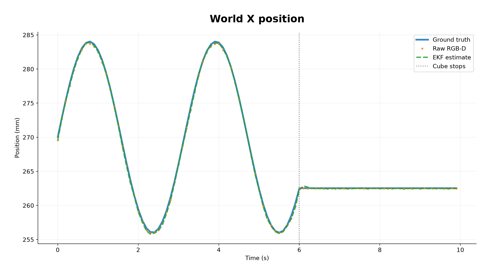

*Figure C1. base X position: ground truth, raw RGB-D and EKF estimate.*

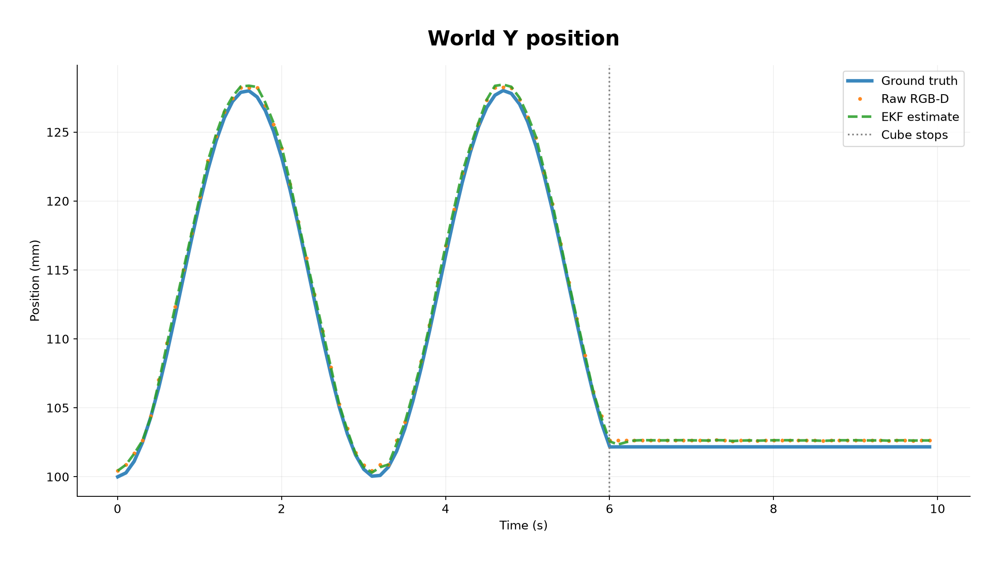

*Figure C2. base Y position: ground truth, raw RGB-D and EKF estimate.*

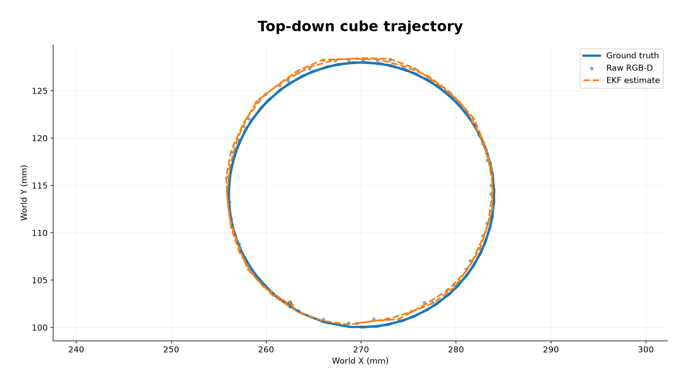

*Figure C3. Top-down XY trajectory comparing ground truth, RGB-D detections and EKF estimates.*

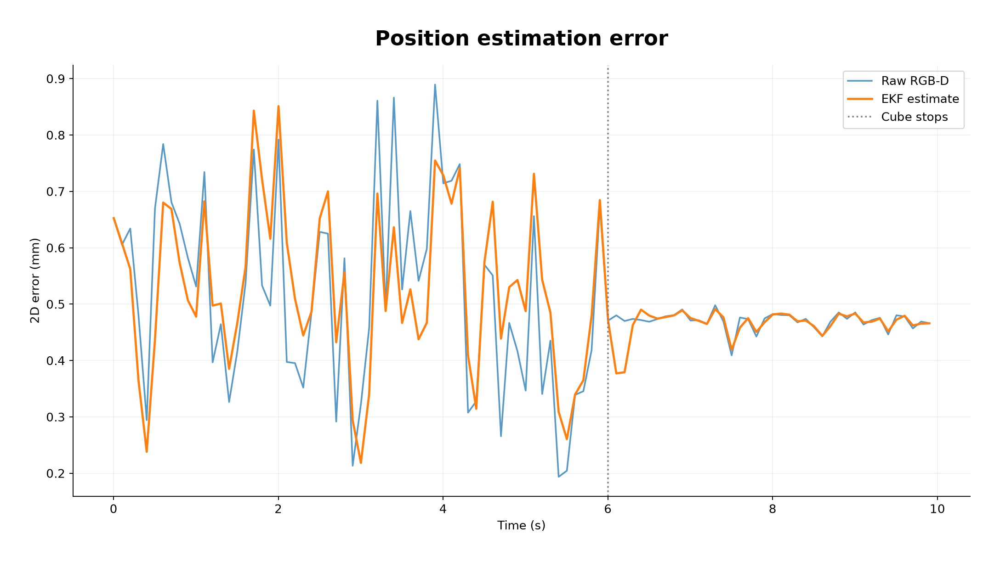

*Figure C4. Two-dimensional position error. This figure should be interpreted alongside measured RMSE; the EKF is not assumed to outperform raw localisation in every interval.*

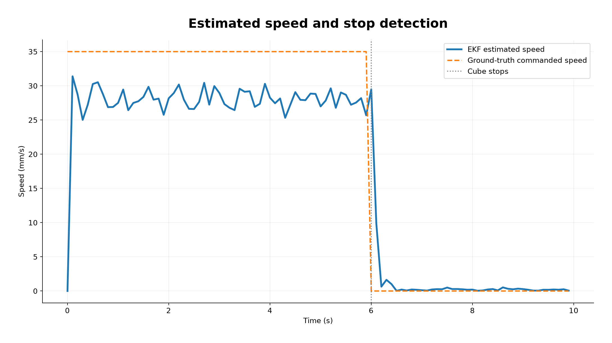

*Figure C5. EKF-estimated speed versus the prescribed motion-driver speed; the cube stops at 6 s.*

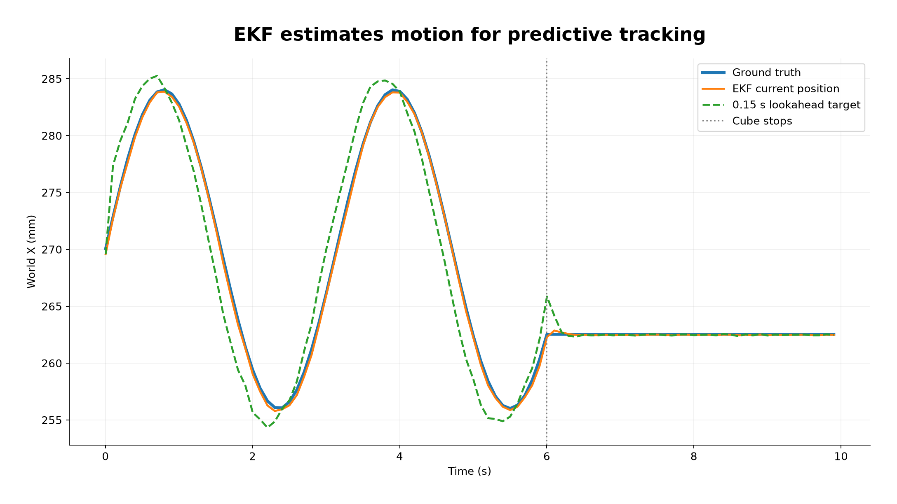

*Figure C6. Current EKF X-position and 0.15-second predictive target. This is not a robot TCP tracking plot.*

#### Quantitative Results (Fixed-Scan Test N)

The corrected isolated test detected the cube in **100/100 frames** and accepted **100/100 EKF measurement updates**.

| Interval | Raw RGB-D 2D position RMSE | EKF 2D position RMSE |
|---|---:|---:|
| Moving (0–6 s) | 0.5304 mm | 0.5330 mm |
| Stopped (from 7 s) | 0.4665 mm | 0.4663 mm |
| Entire trial | 0.5070 mm | 0.5069 mm |

After stopping, the mean EKF-estimated speed was **0.000196 m/s (0.196 mm/s)**. These results show reliable detection and sub-millimetre position estimation in this particular fixed-scan test. **The EKF’s overall position RMSE is essentially identical to raw RGB-D in this trial (0.5069 mm versus 0.5070 mm)**. Its additional value is estimating velocity and enabling short-horizon prediction. These figures are from a single dedicated test not a statistical guarantee across randomised trials.

#### Posterior Covariance and ±3σ Consistency

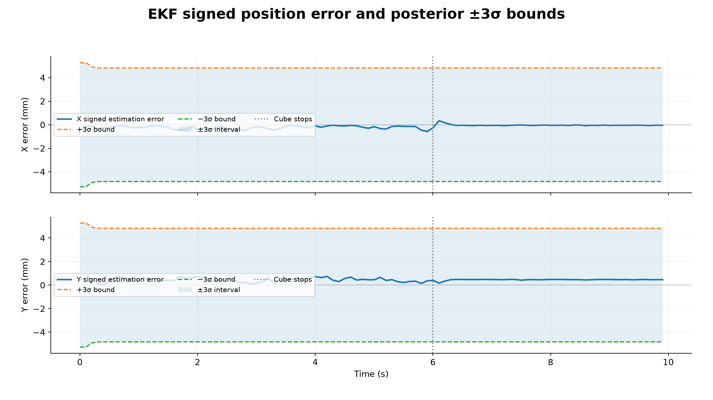

*Figure C7. Signed EKF X and Y estimation errors compared separately with posterior ±3σ bounds computed from $P_{xx}$ and $P_{yy}$. The bounds express the filter's model-based marginal uncertainty, not a guaranteed error limit.*

Over the trial, 99% of the signed errors stay inside the ±3σ bounds. The CSV also records `sigma_x` and `sigma_y` for reproducibility.

**Evaluation scope:** Test N isolates cube sensing and estimation. It uses the simulated joint configuration for camera localisation. It therefore does not validate the full joint-observer and LQR pipeline or disturbance robustness. The separate integrated 12/12 nominal pick-and-lift regression should be reported under system integration not as Test N EKF accuracy.


### Section 5.7 Joint Observer

The encoders measure the joint angles only. A second Kalman filter is then used to estimate all of the joint angles and velocities from those noisy readings. The controller runs on this estimate and never reads the true state of the joints.

**Model.** Each joint is a double integrator, driven by the acceleration the controller commanded:

$$
\begin{bmatrix}q\\ \dot q\end{bmatrix}_{k+1}=
\begin{bmatrix}1&\Delta t\\0&1\end{bmatrix}
\begin{bmatrix}q\\ \dot q\end{bmatrix}_{k}+
\begin{bmatrix}\Delta t^2/2\\ \Delta t\end{bmatrix}a_k+w_k,\qquad
y_k=q_k+v_k
$$

Using the commanded acceleration as a input means the filter does not have to accept the arms motion as noise. The process noise $w_k$ (acceleration standard deviation 1.0 rad/s²) only is there to cover what the acceleration does not explain. The encoder noise $v_k$ has standard deviation 0.0005 rad. The covariance uses the Joseph form.

**Result** (joint 2, circle path, seed 42, nominal run):

| Quantity | Value |
|---|---|
| Angle error RMS | 0.160 mrad |
| Velocity error RMS | 0.0049 rad/s |
| Inside ±3σ, angle | 100.00 % |
| Inside ±3σ, velocity | 99.87 % |

Both percentages are at or above 99.7% expected for a consistent Gaussian filter, so the uncertainty reported by the filter is not too much. velocity is never measured so the error is for a state from purely angle readings. The error is measured against true state for evaluation only.


## 6. Simulation and Controller Parameters

The following tables summarise the default parameters used in the integrated UR3e moving-cube tracking and pick-and-lift simulation. Values are taken from all the working files of the team. Unless otherwise stated, these are nominal settings, command-line arguments can override selected values.

### 6.1 Simulation and RGB-D Sensing

| Parameter | Default value | Unit / Description |
|---|---|---|
| Robot | UR3e | 6-DOF manipulator |
| Simulator | MuJoCo | Physics simulation |
| Control timestep | `m.opt.timestep` | s; defined by the MuJoCo model |
| Camera resolution | 640 × 480 | pixels |
| Camera sampling interval | 0.10 | s (10 Hz) |
| Cube size | 0.04 | m |
| Cube-top reference height | 0.04 | m |
| RGB noise standard deviation | 4.0 | image intensity units |
| Depth noise standard deviation | 0.001 + 0.005 × depth² | m; depth-dependent |
| Encoder noise standard deviation | 0.0005 | rad |
| Camera noise scale | 1.0 | `--depth-noise` |
| Encoder noise scale | 1.0 | `--enc-noise` |

### 6.2 Cube Extended Kalman Filter

| Parameter | Default value | Unit / Description |
|---|---|---|
| State vector | [px, py, vx, vy] | 4 states |
| Process model | Constant velocity | Planar cube motion |
| EKF prediction interval | 0.10 | s nominal; elapsed time can be used |
| Acceleration noise standard deviation | 0.30 | m/s² |
| Pixel measurement noise | 2.0 | px per axis |
| Depth measurement noise | 0.006 | m |
| Initial position uncertainty | 0.02 | m standard deviation |
| Initial velocity uncertainty | 0.20 | m/s standard deviation |
| Initial velocity estimate | 0 | m/s |
| Prediction horizon | 0.15 | s (`--tau`) |
| Measurement covariance | diag(4, 4, 0.000036) | px², px², m² |

### 6.3 Joint-State Observer

| Parameter | Default value | Unit / Description |
|---|---|---|
| State dimension | 12 | 6 joint positions + 6 velocities |
| Measured states | Joint positions | 6 encoder readings |
| Observer model | Double-integrator driven by the commanded acceleration | Discrete Kalman filter |
| Observer timestep | `m.opt.timestep` | s |
| Acceleration process noise | 1.0 | rad/s² |
| Assumed encoder noise | 0.0005 | rad at nominal scale |
| Observer encoder-noise scale | 1.0 | `--obs-enc-scale` |
| Initial velocity estimate | 0 | rad/s |
| Initial velocity uncertainty | 0.5 | rad/s standard deviation |
| Covariance update | Joseph form | Numerical robustness |

### 6.4 Computed-Torque and LQR Controller

| Parameter | Default value | Unit / Description |
|---|---|---|
| Controller | Computed torque + discrete LQR | Joint-space feedback |
| LQR position weight | 2500 | `q_w` |
| LQR velocity weight | 1.0 | `qd_w` |
| LQR acceleration-effort weight | 1.0 | `r` |
| LQR state | [joint position error, joint velocity error] | Per joint |
| Control timestep | `m.opt.timestep` | s |
| Joint 1–2 torque limits | ±56 | Nm |
| Joint 3 torque limit | ±28 | Nm |
| Joint 4–6 torque limits | ±12 | Nm |
| Reference joint-step limit | 0.016 | rad per camera update |
| Joint-velocity feedforward limit | 0.6 | rad/s |
| Velocity feedforward DLS damping | 0.03 | Jacobian |
| IK DLS damping (λ²) | 4e-4 | Jacobian damping |
| Controller model mass scale | 1.0 | `--mass-mismatch` |

The LQR gains are calculated using the discrete algebraic Riccati equation. They are not fixed numerical gains entered manually.

### 6.5 Tracking, Pick and Safety Logic

| Parameter | Default value | Unit / Description |
|---|---|---|
| Moving-cube trajectory stop time | 6.0 | s |
| Temporary pause start | 3.0 | s |
| Temporary pause duration | 0.20 | s (2 camera frames) |
| Stationary speed threshold | 0.003 | m/s |
| Tracking TCP-to-cube tolerance | 0.005 | m |
| Stationary confirmation | 5 | consecutive camera frames |
| Verification duration | 0.30 | s |
| Verification position tolerance | 0.003 | m |
| Maximum fresh-detection age | 0.15 | s |
| Approach target height | 0.12 | m |
| Approach duration | 1.5 | s |
| Approach motion speed threshold | 0.004 | m/s |
| Approach displacement abort threshold | 0.005 | m |
| Descent duration | 2.0 | s |
| Descent target height | 0.035 | m |
| Lift distance command | 0.15 | m |
| Lift duration | 1.5 | s |
| Successful lift threshold | 0.10 | m |
| Maximum trial simulation time | 20.0 | s |

### 6.6 Randomisation and Robustness Testing

| Parameter | Default / Range | Unit / Description |
|---|---|---|
| Cube starting X offset | ±0.015 | m |
| Cube starting Y offset | ±0.015 | m |
| Cube friction coefficient | 0.5–1.2 | Randomised per trial |
| Cube mass | 0.02–0.08 | kg |
| Lighting scale | 0.6–1.2 | Relative multiplier |
| Motion trajectories | 6 | Horizontal, vertical, diagonal, square, circle, zigzag |
| Trajectory amplitude scale | 1.0 | Maximum nominal scale |
| Workspace X | 0.20–0.34 | m |
| Workspace Y | 0.04–0.16 | m |
| Workspace safety margin | 0.005 | m |
| Added random torque disturbance | 0.0 | Nm standard deviation |
| Constant torque bias | 0.0 | Nm |
| Controller mass mismatch | 1.0 | Nominal model multiplier |
| Default random seed | 42 | Reproducibility |
| Default number of trials | 1 | `--seeds` |
| Simulation mode | Viewer enabled | Use `--headless` for batch tests |

**Notes:** The torque limits are defined in `robot_model/pick_scene.xml`. The physics timestep is read from the MuJoCo model rather than hard-coded in `main.py`. The six motion trajectories are generated by scripted simulation motion while the estimator and controller use sensor-derived estimates. Default disturbance values are zero and non-zero robustness settings must be specified explicitly.

## 7. Sensing and Frames (Part B)

**Sensor.** The wrist-mounted RGB-D camera is simulated in MuJoCo and renders 640 × 480 images at 10 Hz. Artificial noise is added to every frame: gaussian RGB noise (std deviation of 4 intensity units) and depth noise that increases with distance (standard deviation 0.001 + 0.005 × depth² m). Ground truth again is never used by the sensing pipeline

**Detection.** The red cube is found by colour. The RGB image is converted to HSV (hue saturation value), thresholded on a red mask, as the largest blob of the detected pixels is treated as the cube. The centroid of the cube gives its pixel position $(u, v)$ and the median depth of the blob gives $Z$. if no cube/blob is found the frame is rejected.

**From pixels to the base frame.** A pixel and its depth are turned into a 3D point with the inverse of the camera matrix, then moved through the camera pose into the robot base frame:

$$
\begin{bmatrix}X_c\\Y_c\\Z_c\end{bmatrix}=
Z\,K^{-1}\begin{bmatrix}u\\v\\1\end{bmatrix},\qquad
K=\begin{bmatrix}f_x&0&c_x\\0&f_y&c_y\\0&0&1\end{bmatrix}
$$

$$
\mathbf{p}_{base}=R_{bc}\,F\,\mathbf{p}_c+\mathbf{t}_{bc}
$$

- $F=\mathrm{diag}(1,-1,-1)$ converts from the image (optical) convention to MuJoCo's camera convention, where the camera looks along its own $-z$ axis.
- $R_{bc}$ and $\mathbf{t}_{bc}$ are the camera's orientation and position in the base frame. These come from the kinematics of the **estimated** joint angles $\hat q$ (section 5.7), not the true ones. This is also setup to be eye in hand, the camera moves with the arm so its pose is recomputed every frame.

- 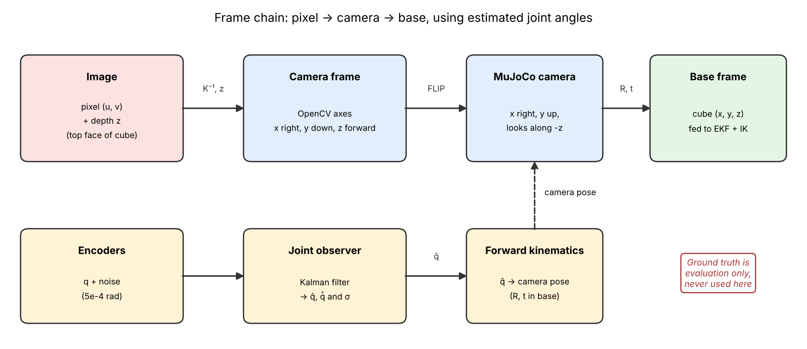
*Figure B1. Coordinate frames and the estimation chain from encoders to the base-frame cube position. Ground truth is used for evaluation only.*

**Calibration.** The intrinsics of the camera were calibrated using the chessboard procedure (OpenCV `calibrateCamera`). A board (8 × 6 squares, 20 mm) was rendered from 20 different poses using the wrist camera's specification, the inner corners were found and refined to sub-pixel accuracy, and the intrinsic matrix was fitted:

| Parameter | Calibrated value |
|---|---|
| $f_x$ | 376.43 px |
| $f_y$ | 376.51 px |
| $c_x$ | 319.53 px |
| $c_y$ | 239.13 px |
| Reprojection error (RMS) | 0.133 px (worst view 0.182 px) |

The focal length of the camera differs from the simulators nominal value (376.72 px) by 0.08 %. The distortion terms  ($k_1 = 0.0245$, $k_2 = -0.1705$) are fitting items: the camera simulated has an ideal pinhole with no lens distortion, so no correction is applied The calibrated focal length is loaded by the sensing code (`results/calibration.npz`) and the principal point is kept at the image centre.

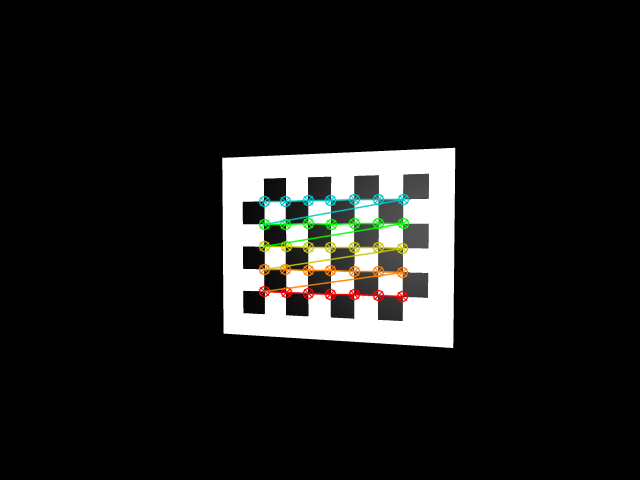
*Figure B2. Detected chessboard corners from the calibration views.*

**Limitations of the sensing.** The position of the cube uses the blobs median depth not the depth of its top face, so there's a tiny bias that's carried accross and is dependent on viewing angle. There is no hand-eye calibration the camera's mounting pose on the wrist is taken from the model, not estimated.


## Results

### Nominal batch: 12 seeds, all six paths

`python main.py --seeds 12 --headless` runs seeds 42–53 (two per path, cycling through the six paths), with randomised cube start, friction, mass and lighting each time.

| Seed | Path | Result | Aborted countdowns |
|---|---|---|---|
| 42 | circle | success | 2 |
| 43 | horizontal | success | 1 |
| 44 | vertical | success | 5 |
| 45 | diagonal | success | 2 |
| 46 | square | success | 6 |
| 47 | zigzag | success | 1 |
| 48 | circle | success | 1 |
| 49 | horizontal | success | 2 |
| 50 | vertical | success | 2 |
| 51 | diagonal | success | 3 |
| 52 | square | success | 3 |
| 53 | zigzag | success | 4 |

**12/12 picks succeeded (100 %)**, 2/2 on every path. A pick counts as a success if the cube rises more than 0.10 m. Ground truth is used only to evaluate this.

An aborted countdown is when the cube stops moving and the check restarts, across all the trials there were 32 aborts and every trial had at least 1 abort. These are not failures but a result of the architecture of the program, the cube is required to be at 3mm/s for five camera frames and the cubes speed is sometimes noisy enough that it crosses that line, the system will simply wait and count again.


### Normal versus disturbed trial (seed 42, circle path)

Under disturbance the joint 2 velocity error rises by 37% (0.0049 → 0.0067 rad/s) and the angle by 7% (0.160 → 0.171 mrad), while both stay strikingly close to the consistency target (99.72 % for velocity) the cube position error at rest is unchanged (0.39 mm → 0.40 mm), and the pick still succeeds.

| | Normal | Disturbed (0.2 Nm torque noise) |
|---|---|---|
| Pick result | success | success |
| Aborted countdowns | 2 | 6 |
| Joint 2 angle error (RMS) | 0.160 mrad | 0.171 mrad |
| Joint 2 velocity error (RMS) | 0.0049 rad/s | 0.0067 rad/s |
| Inside ±3σ (angle / velocity) | 100.00 % / 99.87 % | 100.00 % / 99.72 % |
| Cube position error at rest | 0.39 mm | 0.40 mm |

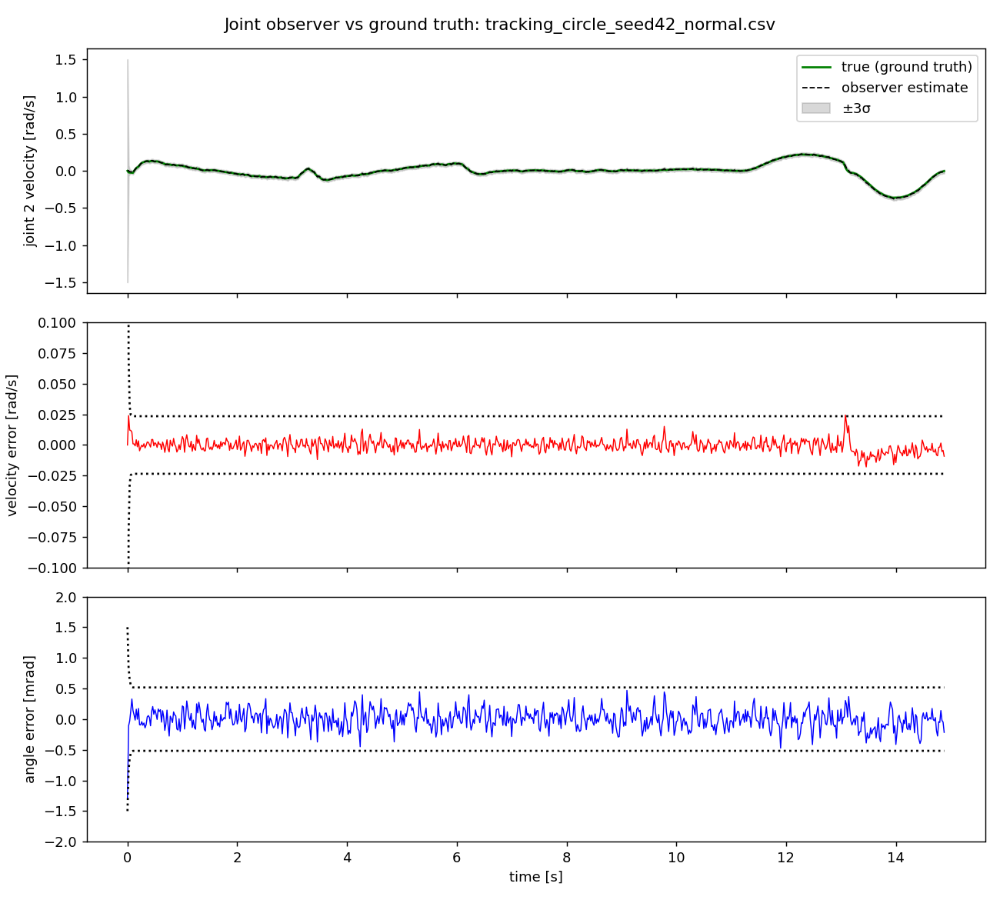
*Figure R1. Normal trial: estimated and true joint 2 angle and velocity, with ±3σ bounds.*

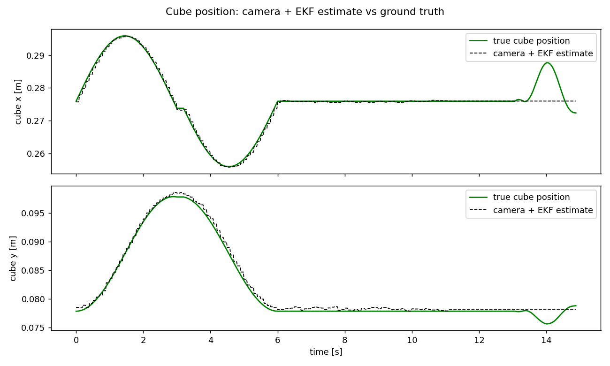
*Figure R2. Normal trial: estimated and true cube position.*

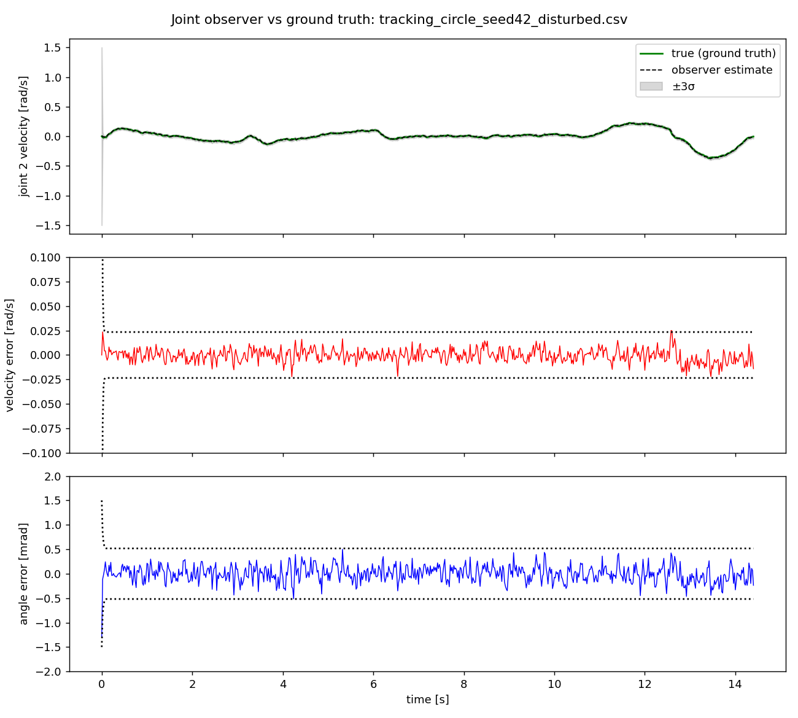
*Figure R3. Disturbed trial: estimated and true joint 2 angle and velocity, with ±3σ bounds.*

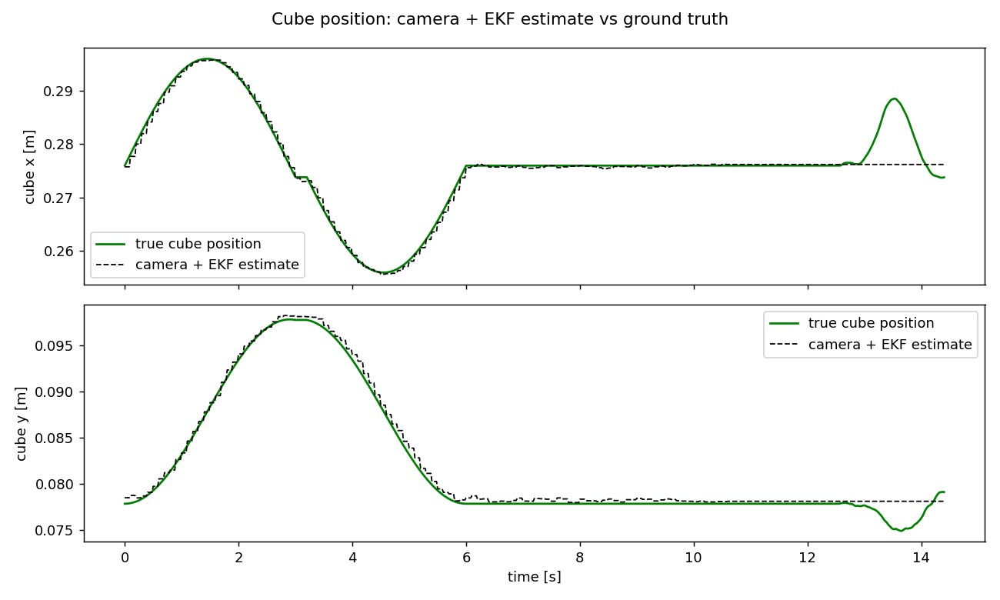
*Figure R4. Disturbed trial: estimated and true cube position.*

In the standard trial the cubes position error is 1.13mm on average over the trial, and 0.39mm once the cube is at rest. The largest error is 12mm, in the early transient while the filter starts and arm moves to pick. The disturbed trial stays inside the bounds and picks successfully, but needs more aborts/countdown restarts due to extra torque noise that makes the arm jitter slightly.

## Limitations and Failure Analysis
Every failure below was traced to a specific cause rather than guessed at.


| Test | Result | Diagnosed cause |
|---|---|---|
| Encoder noise ×3 (`--enc-noise 3 --obs-enc-scale 3`) | stuck in APPROACH, 22–29 aborts | the noisier $\hat q$ makes the cube estimate noisier, so the cube's speed estimate at rest sits above the 3 mm/s threshold and the stopped-check never completes |
| Depth noise ×2 (`--depth-noise 2`) | stuck in APPROACH, 22–29 aborts | same mechanism: noisier measurements, noisier velocity estimate |
| Encoder noise ×10 with the observer matched to it | filter stayed consistent (99.98 % inside ±3σ) but the pick still failed | the *estimator* was correct; the *pick logic* is what is too tight, because its threshold is fixed |
| Controller mass ×1.3 plus a constant 2 Nm torque bias | failed | there is no integral action, so a constant disturbance leaves a steady tracking offset that proportional-derivative feedback alone cannot remove |


**What this tells us.** The estimator and the controller degrade gracefully, but the pick is where it's weak: the 3mm/s trade off is a tradeoff between waiting for certainty and being robust to noise. A rate threshold that scaled with the estimator's own uncertainty would remove the first three failures.

**Other limitations**
- No integral action, so constant torque biases and large model errors are not rejected.
- The cube depth used by the EKF is the median depth of the whole blob, not the depth of the top face.
- The descent and lift are open-loop from the locked position: if the cube moved after lock-in, the arm would not see it.
- The suction grasp is a weld constraint created at contact from the true relative pose, a simulation shortcut.
- The model has no joint friction or damping; damping comes from the controller.
- No hand-eye calibration. The camera mount pose is taken from the model.
- The cube moves in translation only; its orientation is fixed, so there is no yaw estimate.
- Simulation only. The workspace check is sampled inverse kinematics plus camera field of view, not continuous collision checking, and there is no physical robot safety validation.


